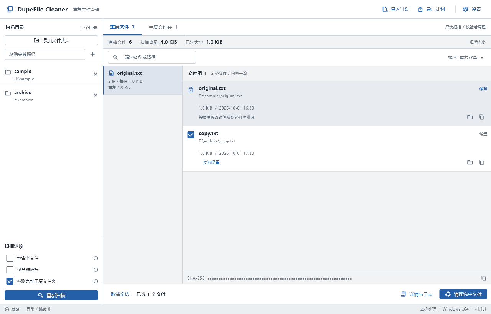
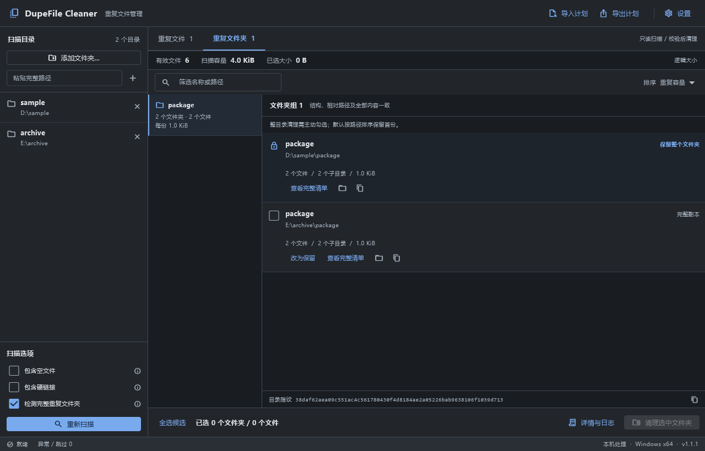

# DupeFile Cleaner

[](https://github.com/blockshy/DupeFileCleaner/actions/workflows/ci.yml)
[](https://github.com/blockshy/DupeFileCleaner/releases/latest)
[](LICENSE)
[](https://github.com/blockshy/DupeFileCleaner/releases)

**Find, inspect, and clean up duplicate files and complete duplicate folders in a focused desktop workspace.**

[中文](README.md) | English

DupeFile Cleaner is a Windows desktop application built with Flutter, Dart, and native Windows APIs. It compares file contents, scans multiple directories together, lets you choose which copy to keep, and records individual cleanup operations. Scanning and verification run locally without an account or online service. The application interface is currently in Simplified Chinese.

## Download

Download `DupeFileCleaner-v<version>-windows-x64.zip` from the [latest release](https://github.com/blockshy/DupeFileCleaner/releases/latest), extract the entire archive, and run `dupe_file_cleaner.exe`.

- Targets Windows 10/11 x64 as a portable ZIP distribution.
- Keep the bundled DLLs and `data` directory beside the executable.
- Each release includes a SHA-256 checksum file.
- Release packages are unsigned and are not installers.

## Features

| Feature | Behavior |
|---|---|
| Multiple scan locations | Groups duplicates across roots and merges redundant or nested scan ranges |
| Content-based detection | Filters by size and sampled hashes, then confirms with a complete SHA-256 hash |
| Complete duplicate folders | Compares relative paths, file contents, and directory structure, including empty files and subdirectories |
| Explicit keeper selection | Keeps one copy in each group and lets you change the keeper and cleanup selection |
| Sequential cleanup | Updates affected results while preserving unrelated groups and remaining copies |
| Recycle or permanently delete | Defaults to the Recycle Bin; permanent deletion requires typing `DELETE` |
| Plans and operation history | Exports selected candidates, verifies imported plans, and writes per-item logs |
| Desktop themes | Light, dark, and system appearance with a saved preference |

## Screenshots

Screenshots use synthetic example data.





## Quick start

1. Add folders using the Windows picker with Ctrl / Shift, or enter a full path.
2. Review the options and start scanning. Scanning does not delete files and can be cancelled.
3. Review the file or folder results, full paths, keepers, and selected candidates. Folder candidates require an explicit selection.
4. Confirm the cleanup count and paths, then choose the Recycle Bin or permanent deletion.
5. Inspect the results and logs, continue with remaining groups, or export selected candidates.

## Boundaries

- Detection finds exact content matches, not visually similar images, similar documents, or name-only matches.
- Folder cleanup also requires matching relative paths and structure. Each tree is limited to **8192 files and subdirectories**; smaller eligible duplicate subtrees can still be listed when a parent exceeds the limit.
- Reparse points, symbolic links, and junctions are excluded. Whole-folder candidates must also be free of hard links, unreadable items, and changes detected during scanning.
- Recycling is limited to local fixed drives. A failed recycle operation never falls back to permanent deletion.
- Cleanup rechecks file identity and full content. Windows Shell recycling still has an unavoidable path-change race window; stop concurrent writes before cleaning active directories.
- Permanent deletion cannot be restored through the Recycle Bin. Cancelling stops pending work but does not undo completed operations.

## Documentation and development

The detailed documentation is currently available in Chinese:

- [User guide](docs/usage.md)
- [Development and release guide](https://github.com/blockshy/DupeFileCleaner/blob/main/docs/development.md)
- [Contributing](https://github.com/blockshy/DupeFileCleaner/blob/main/CONTRIBUTING.md)
- [Security policy](https://github.com/blockshy/DupeFileCleaner/blob/main/SECURITY.md)
- [Changelog](CHANGELOG.md)

To run from source, install Flutter 3.47.6 and the Visual Studio C++ desktop development workload, then run these commands from the repository root:

```powershell
flutter pub get --enforce-lockfile
flutter run -d windows
```

## License

Original project code is available under the [MIT License](LICENSE). Flutter, Dart, fonts, and other dependencies retain their own licenses. See [Third-party notices](THIRD_PARTY_NOTICES.md).
