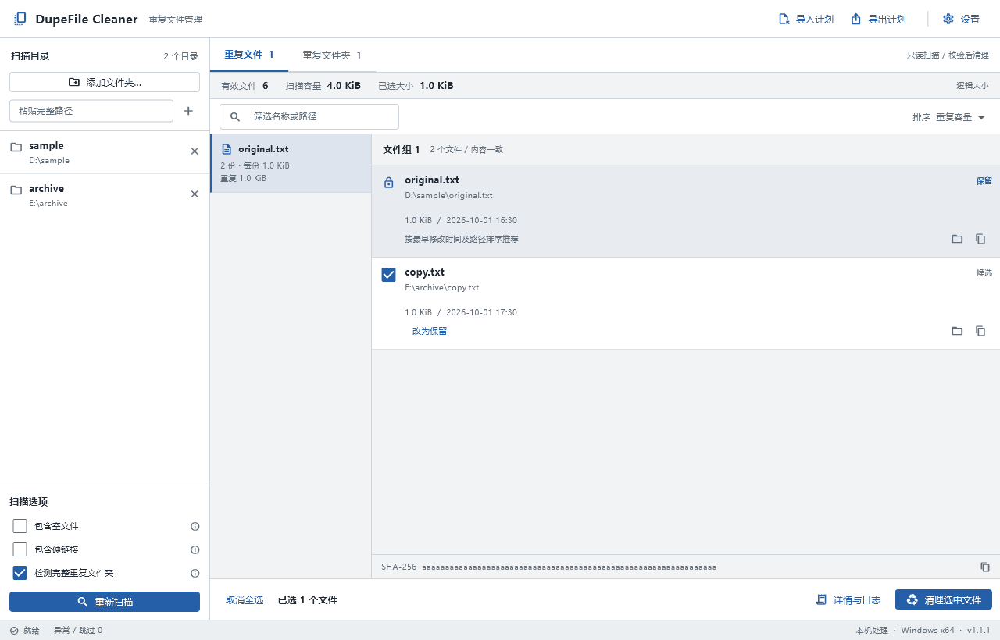
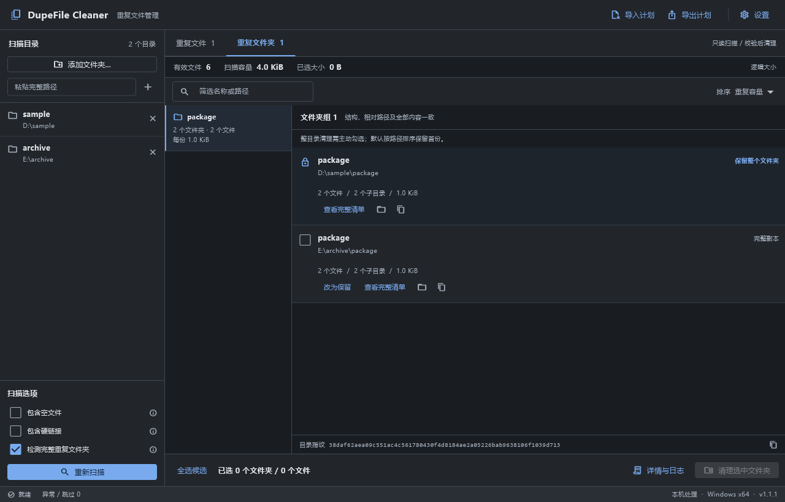

# DupeFile Cleaner

[](https://github.com/blockshy/DupeFileCleaner/actions/workflows/ci.yml)
[](https://github.com/blockshy/DupeFileCleaner/releases/latest)
[](LICENSE)
[](https://github.com/blockshy/DupeFileCleaner/releases)

**在清晰的桌面工作台中查找、核对并清理重复文件与完整重复文件夹。**

中文 | [English](README.en.md)

DupeFile Cleaner 是使用 Flutter、Dart 和 Windows 原生接口构建的桌面工具。它根据文件内容判重，支持多个目录联合扫描、人工指定保留副本、清理预览及逐项操作日志。扫描与内容校验在本机完成，无须账号或联网服务。

## 下载与运行

从 [最新 Release](https://github.com/blockshy/DupeFileCleaner/releases/latest) 下载 `DupeFileCleaner-v<版本>-windows-x64.zip`，完整解压后运行 `dupe_file_cleaner.exe`。

- 面向 Windows 10/11 x64；当前发行形式为便携 ZIP。
- 保留包内 DLL 与 `data` 目录，不能只复制 EXE。
- Release 同时提供 SHA-256 校验文件。校验方法见[使用指南](docs/usage.md#下载与校验)。
- 发行包未进行代码签名，也不是安装程序。

## 功能

| 能力 | 说明 |
|---|---|
| 多目录扫描 | 一次扫描多个文件夹，跨目录统一分组，自动合并重复或嵌套范围 |
| 内容判重 | 文件大小与首尾摘要先筛选，完整 SHA-256 决定最终分组 |
| 完整文件夹判重 | 检查相对路径、全部文件内容及子目录结构，包括空文件和空子目录 |
| 明确保留项 | 每组保留一份，支持手动更换保留对象及选择清理候选 |
| 连续清理 | 清理后更新受影响结果，其余副本和独立分组继续可用 |
| 两种清理方式 | 默认移入 Windows 回收站；永久删除须输入 `DELETE` |
| 计划与日志 | 导出选中项、重新复核导入计划、保存逐项执行记录 |
| 桌面主题 | 浅色、深色、跟随系统，自动保存偏好 |

## 界面

截图使用合成示例数据。





## 快速开始

1. 点击“添加文件夹…”，使用 Ctrl / Shift 多选，或输入完整路径后添加。
2. 确认扫描选项，点击“开始扫描”。扫描本身不会删除文件，期间可以取消。
3. 在“重复文件”或“重复文件夹”页核对完整路径、保留项和清理候选。文件夹候选需要主动勾选。
4. 点击当前页的清理按钮，确认数量与路径，选择回收站或永久删除。
5. 查看结果与日志，继续处理剩余分组，或导出尚未处理的选中项。

完整操作、判重细节和故障处理请阅读[使用指南](docs/usage.md)。

## 使用边界

- 判重针对完全一致的内容，不识别相似图片、相似文档或仅名称相同的文件。
- 整文件夹清理要求相对路径和结构也一致；单棵树最多包含 **8192 个文件及子目录**。超限父树会被跳过，其中符合上限的重复子树仍可列出。
- 重解析点、符号链接和目录连接点不参与清理；完整文件夹树还要求不存在硬链接、读取失败或扫描中变化的项目。
- 回收站模式仅适用于本地固定磁盘，失败时不会自动改为永久删除。
- 清理前重新校验身份与完整内容。Windows Shell 回收操作存在无法完全消除的并发路径变化窗口；处理正在写入的目录前应先停止相关写入。
- 永久删除不可通过回收站恢复；取消任务不会撤销已经完成的操作。

## 文档与贡献

- [使用指南](docs/usage.md)：选项、目录判重、连续清理、计划、日志与常见问题。
- [开发指南](https://github.com/blockshy/DupeFileCleaner/blob/main/docs/development.md)：环境、项目结构、测试、打包及版本发布。
- [贡献指南](https://github.com/blockshy/DupeFileCleaner/blob/main/CONTRIBUTING.md)：报告问题、提交更改与代码规范。
- [安全说明](https://github.com/blockshy/DupeFileCleaner/blob/main/SECURITY.md)：文件操作边界与漏洞报告。
- [更新记录](CHANGELOG.md)：面向用户的版本说明。

需要从源码运行时，安装 Flutter 3.47.6 和 Visual Studio C++ 桌面开发工具，然后在项目根目录执行：

```powershell
# 安装锁定的依赖并启动 Windows 桌面程序。
flutter pub get --enforce-lockfile
flutter run -d windows
```

## 许可证

项目原创代码使用 [MIT 许可证](LICENSE)。Flutter、Dart、字体和其他依赖保留各自的许可证，详见[第三方声明](THIRD_PARTY_NOTICES.md)。
